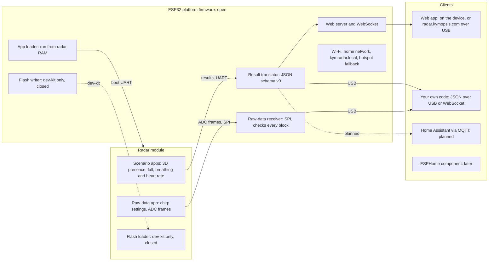

# Kymopsis Radar Base: architecture

Updated 2026-11-15. Public-facing: no radar chip or vendor names in this file.

Radar Base is an ESP32-S3 board that runs a 60 GHz mmWave radar module and makes its results available
over USB, home Wi-Fi and smart-home systems. The radar does the radar work; the ESP32 loads radar apps,
turns their results into one JSON format and serves them; PCs, phones and home hubs only consume JSON
(or, for algorithm work, raw data over USB).

## Layers

| Layer | What it is | Where |
|---|---|---|
| Radar scenario apps | Ready-made radar apps that do the full signal chain on the radar and report results (people positions, areas, fall, breathing and heart rate) | Run on the radar; loaded into its RAM by the ESP32, or stored in its flash on dev-kit units |
| Raw-data app | Kymopsis radar app that streams ADC frames with runtime chirp, gain and filter settings | Radar; source not public |
| ESP32 platform (open) | App loader, JSON translator, raw-data receiver, web app and WebSocket, Wi-Fi, USB console | `esp32-flasher-test/` |
| Dev-kit module (closed) | Writes the radar's flash (with a backup first). No internet, no data collection | `esp32-flasher-test/main/devkit/`, dev-kit firmware only |
| JSON schema v0 | One contract for every client: `cap`, `targets`, `zones`, `fall`, `vital` | `pc-gui/SCHEMA.md` |
| Web app | Task picker, scenario views, firmware writing, raw-data settings, Wi-Fi, diagnostics; 11 languages | Served by the ESP32 at `/`; same app hosted at radar.kymopsis.com (over USB) |
| Results viewer (PC) | JSON results viewer and example client | `pc-gui/app_views.py` (Python) |
| Smart home | MQTT with Home Assistant discovery (next), ESPHome external component (later) | planned |

## Connections, in order of preference

1. **USB.** Plug Radar Base into a PC. The web app in Chrome/Edge
   (Web Serial). Raw ADC data only travels over USB (about 0.5 MB/s usable).
2. **Home Wi-Fi.** Radar Base joins the home network and is reachable at `http://kymradar.local` (or its IP).
   Results stream over WebSocket. No extra network, no cloud.
3. **Hotspot (fallback).** `KymRadarBase-xxxx` at `http://192.168.4.1` turns on only when no home network is
   saved or it cannot be reached for 30 s; it opens the setup page automatically (captive portal) and turns
   itself off once the home network works.
4. **Smart home.** MQTT to the user's own broker (e.g. the Home Assistant Mosquitto add-on) with Home Assistant
   discovery; ESPHome later. Kymopsis runs no broker and no cloud.

## Where algorithms run

Rule: prototype on the PC first; then check whether the radar's own hardware (FFT and CFAR units) can do it,
and if so run it on the radar and send only results; otherwise check the ESP32 (CPU, RAM, latency); keep it on
the PC only if neither fits.

| Algorithm | Today | Target | Measured cost |
|---|---|---|---|
| Range FFT | Radar (inside scenario apps); PC for raw data | Radar FFT unit | PC: 20 µs per 256-sample frame, 108 µs per 1024×16 frame (one laptop core) |
| Doppler FFT | Radar (scenario apps); PC | Radar FFT unit | PC: 99 µs per 16×513 frame |
| CFAR detection | Radar (scenario apps) | Radar CFAR unit | not measured separately |
| Angle (2 RX, 2 TX) | Radar (scenario apps) | Radar | not measured |
| People tracking, areas | Radar (scenario apps) | Radar | results at 16 to 20 per second |
| Breathing, heart rate | Radar (scenario app, 2 per second); PC (own chain) | Radar for rates; ESP32 under evaluation | PC chain: 10 ms per update on a 30 s window |
| Beat-to-beat intervals, HRV | PC | PC until beat timing is reliable | 10 ms per update (same chain) |
| Fall detection | Radar (scenario app) | Radar | results at about 20 per second |

ESP32 costs have not been measured yet; they will be added when an algorithm is a candidate for the ESP32.

## Open and dev-kit firmware

One source tree, two builds (see `esp32-flasher-test/BUILDS.md`). The OPEN build runs every radar app from RAM and
is the public firmware. The DEV-KIT build adds only the closed flash-writing module. Every OPEN build is checked
automatically for loader content.

## Developer quick start

1. **Wire** the ESP32-S3 DevKit to the radar carrier by the carrier's silkscreen labels (table in the getting-started
   guide): GND, RX0/TX0, RX1/TX1, RST, P12, P19, SPI CLK, SPI MOSI.
2. **Flash the ESP32** (ESP-IDF v6.0): `idf.py -p COMx flash` in `esp32-flasher-test/` (OPEN build).
3. **Try it**: on the USB console type `ver`, then `ram hd3d.bin`, then `jsonout on` to see JSON results; or open the
   web app (hotspot `KymRadarBase-xxxx`, password `kymradar`, `http://192.168.4.1`) and pick a scenario.
4. **Join home Wi-Fi**: web app → Device settings → Home Wi-Fi, or console `wifi <ssid> <password>`; then
   `http://kymradar.local`.
5. **Raw-data settings and self-test**: app -> Raw data & radar settings, or `cfg` keys on the console.
6. **Your own client**: read one JSON line per message from USB (`jsonout on`) or `ws://kymradar.local/ws`; format in
   `pc-gui/SCHEMA.md`; Python example: `python pc-gui/app_views.py --serial COM5`.
